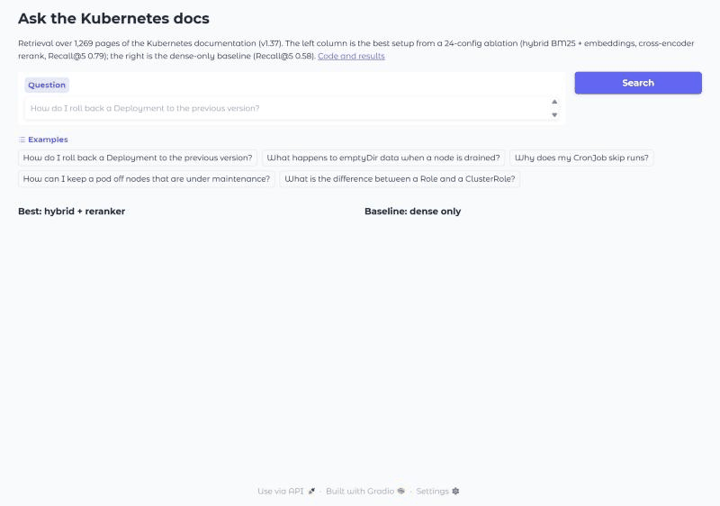
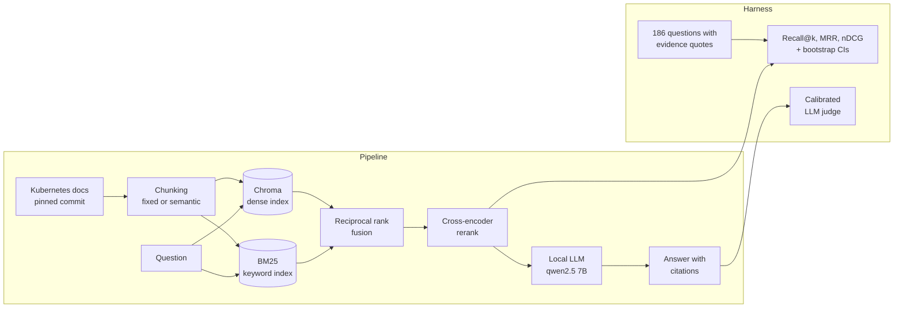
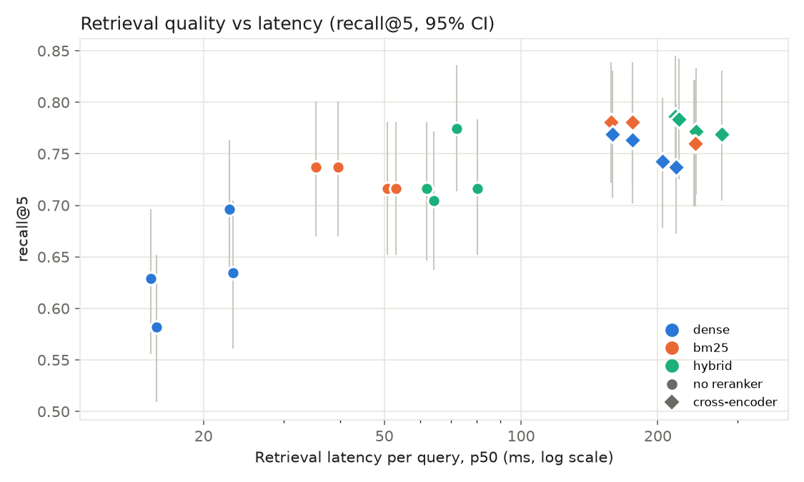

# RAG with Evaluation Harness

[](https://github.com/AbdulMuhaiminKhan/rag-eval-harness/actions/workflows/ci.yml)


A question-answering system over the Kubernetes documentation, built around an evaluation
harness that **measures every design choice instead of assuming it helps**. Twenty-four
retrieval setups were compared on 186 reviewed questions, with confidence intervals, and a CI
gate stops any change that makes retrieval worse.



## Key results

- **Retrieval:** the best setup (BM25 + embeddings fused, then a cross-encoder reranker) finds
  the evidence in its top 5 for **78.7%** of answerable questions, against **58.2%** for plain
  embedding search (+0.205, paired 95% CI +0.135 to +0.272).
- **Biggest lever:** the reranker beat every other change. Semantic chunking and a larger
  embedding model made no reliable difference once it was in place.
- **Answers:** a local 7B model answers **82.5%** of answerable questions correctly and **93%**
  faithfully to the retrieved passages, and declines all 15 unanswerable questions.
- **Judging:** the model that writes the answers is a poor judge of them. Its faithfulness
  labels agree with the reference labels no better than chance, so answers are graded by an
  independent gemma2 9B judge, chosen by calibration.
- **Cost:** $0. Everything runs locally: Chroma, sentence-transformers, BM25, Ollama.

## Contents

- [How it works](#how-it-works)
- [Results](#results)
- [How it is evaluated](#how-it-is-evaluated)
- [Quick start](#quick-start)
- [Reproducing the results](#reproducing-the-results)
- [CI regression gate](#ci-regression-gate)
- [Limitations](#limitations)
- [Project layout](#project-layout)

## How it works



1. **Ingest:** the English Kubernetes docs (1,269 pages) are fetched at a pinned commit and
   cleaned. Hugo shortcodes are expanded, `kubectl` placeholders like `<pod-name>` are kept, and
   the same commit always produces a byte-identical corpus.
2. **Retrieve:** chunks are searched with embeddings (Chroma), BM25, or both fused with
   reciprocal rank fusion, then optionally reranked by a cross-encoder.
3. **Answer:** the top 5 chunks go to a local LLM through Ollama, which answers with citations
   or declines when the passages don't cover the question. Any OpenAI-compatible endpoint can be
   configured instead.
4. **Measure:** every run records per-question retrieval metrics, per-stage latency traces,
   tokens and cost, then summarises them with bootstrap confidence intervals.

## Results

All numbers come from `rageval` runs on the committed eval set (186 questions, 171 answerable)
over the Kubernetes docs at commit `35aa173` (v1.37). Brackets are 95% bootstrap confidence
intervals over questions. Full tables are in [docs/results](docs/results).

### Retrieval: 24-configuration ablation

Chunking (fixed, semantic) × retriever (dense, BM25, hybrid) × reranker (none, cross-encoder)
× embedding model (all-MiniLM-L6-v2, bge-small-en-v1.5).

| config | Recall@5 | MRR@10 | p50 latency |
|---|---|---|---|
| dense, MiniLM (baseline) | 0.582 [0.51, 0.65] | 0.430 [0.37, 0.49] | 16 ms |
| BM25 | 0.716 [0.65, 0.78] | 0.546 [0.49, 0.61] | 53 ms |
| hybrid (dense + BM25, RRF) | 0.705 [0.64, 0.77] | 0.578 [0.52, 0.64] | 64 ms |
| dense + cross-encoder rerank | 0.769 [0.71, 0.83] | 0.630 [0.57, 0.69] | 159 ms |
| **hybrid + cross-encoder rerank** | **0.787 [0.73, 0.85]** | **0.657 [0.60, 0.72]** | 219 ms |

Fixed 1,000-character chunks with 150 overlap; latency measured on an RTX 4070 laptop GPU.
All 24 configurations are in [docs/results/ablation.md](docs/results/ablation.md).



**One change at a time** (paired bootstrap on the same questions, Recall@5):

| change | Δ Recall@5 [95% CI] |
|---|---|
| add the cross-encoder reranker to dense | +0.187 [+0.123, +0.260] |
| add the cross-encoder reranker to hybrid | +0.082 [+0.026, +0.140] |
| hybrid instead of dense | +0.123 [+0.070, +0.181] |
| hybrid instead of BM25 | −0.012 [−0.064, +0.041] |
| bge-small instead of MiniLM (dense) | +0.053 [−0.018, +0.123] |
| semantic instead of fixed chunks (best config) | −0.015 [−0.073, +0.041] |

What this means:

- **The reranker is the biggest single win.** It still helps on top of hybrid search, at roughly
  150 ms extra per query on a GPU (about 2 s on CPU).
- **BM25 beats dense retrieval overall, but only because of the LLM-drafted questions.** On those
  it wins in all four chunking × embedder pairs. On the 45 hand-written questions it ties in three
  and loses in one, so most of its lead comes from drafts reusing the docs' wording (see
  [Limitations](#limitations)). Fusing it with dense retrieval mostly improves ranking (MRR) rather
  than recall.
- **Semantic chunking and a better small embedder didn't make a reliable difference** once a
  reranker was in place: their intervals cross zero.
- **Where it still fails:** the best config misses the evidence entirely for 19 of 171
  answerable questions: 14 find the right page but the wrong passage, 5 the wrong page.
  Comparison and multi-hop questions are hardest (Recall@5 0.71 and 0.61, against 0.84 for
  factoid). See the failure table in [docs/results/ablation.md](docs/results/ablation.md).

### Answers

The best retrieval config feeds its top 5 chunks to `qwen2.5:7b` through Ollama
([configs/best.yaml](configs/best.yaml)).

| measure | result |
|---|---|
| answers correct (gemma2 9B judge, all 171 answerable) | 0.825 [0.77, 0.88] |
| answers faithful to the passages (same judge) | 0.930 [0.89, 0.96] |
| declines unanswerable questions | 15 of 15 |
| declines answerable questions (false abstention) | 0.070 [0.035, 0.111] |
| generation latency, p50 / p95 | 4.1 s / 7.7 s |
| prompt / completion tokens per query | ~1,190 / ~83 |
| cost per query | $0 (local model) |

Declining an answerable question counts as not correct.

### Choosing a judge you can trust

Three LLM judges graded the same 159 answers (every answerable question the system didn't
decline), and they disagreed sharply:

| judge | correct rate [95% CI] | faithful rate [95% CI] |
|---|---|---|
| qwen2.5 7B, prompt v1 | 0.912 [0.87, 0.96] | 0.698 [0.62, 0.77] |
| qwen2.5 7B, prompt v2 (stricter definitions) | 0.195 [0.14, 0.26] | 0.321 [0.25, 0.39] |
| gemma2 9B, prompt v1 | 0.887 [0.84, 0.93] | 0.925 [0.88, 0.96] |

The two qwen prompts agree on correctness only at chance level (Cohen's kappa 0.05). The
stricter prompt fails plainly right answers, such as "10 old ReplicaSets by default", for not
naming the config field.

To choose between them, 40 sampled answers were graded against all five retrieved passages.
Claude suggested each label, and the author then reviewed and confirmed all 40 (none were
changed). The reasons for each negative label are in
[data/eval/human_labels.jsonl](data/eval/human_labels.jsonl).

| judge | correct: accuracy / kappa | faithful: accuracy / kappa |
|---|---|---|
| qwen2.5 7B, prompt v1 | 0.900 / 0.28 | 0.650 / −0.09 |
| qwen2.5 7B, prompt v2 | 0.275 / 0.04 | 0.400 / 0.06 |
| **gemma2 9B, prompt v1** | **0.875 / 0.38** | **0.925 / 0.36** |

gemma2 9B is the only judge that agrees with the reference on both labels, so it produces the
answer scores above. The reference marked only 3 of 40 answers incorrect and 2 unfaithful, so the
kappas are noisy: treat the headline correctness as about ±0.05, plus some judge error. Every
pairing is in [docs/results/judges.md](docs/results/judges.md).

## How it is evaluated

| what | how |
|---|---|
| Retrieval | Recall@k, MRR@10, nDCG@10 (k = 1, 3, 5, 10) and page-level recall |
| Answers | correctness and faithfulness from a calibrated LLM judge; abstention on unanswerable questions; false abstention on answerable ones |
| Judge calibration | accuracy and Cohen's kappa against a reviewed reference sample |
| Speed and cost | p50/p95 latency per pipeline stage, tokens and USD per query |
| Uncertainty | 95% bootstrap CIs on every headline number; paired bootstrap for comparisons |

### Labels are evidence quotes, not chunk ids

Each answerable question cites a page plus a verbatim quote from it. A retrieved chunk counts as
relevant when it overlaps a quote by at least half of the shorter of the two, and each quote is
credited once. The same labels therefore score any chunking strategy fairly. When the same fact
appears on another page, it is listed as an alternative.

```json
{"qid": "h0001", "question": "What is the maximum size of data a ConfigMap can hold?",
 "type": "factoid", "answerable": true,
 "evidence": [{"doc_id": "concepts/configuration/configmap",
               "quote": "The data stored in a\nConfigMap cannot exceed 1 MiB."}],
 "reference_answer": "1 MiB.", "origin": "hand", "reviewed": true}
```

| type | factoid | procedural | conceptual | comparison | multi_hop | unanswerable |
|---|---|---|---|---|---|---|
| questions | 37 | 60 | 48 | 17 | 9 | 15 |

### How the eval set was built

60 questions are hand-written, including all the multi-hop and unanswerable ones. The rest were
drafted by a local LLM from sampled passages, then reviewed: 126 of 171 drafts were accepted,
and every decision is logged in [data/eval/review_log.jsonl](data/eval/review_log.jsonl). The
drafting step automatically rejects quotes that aren't in the page, questions that copy the
passage's wording, near-duplicates, and boilerplate repeated across many pages (kubectl global
flags, API list parameters), which would make a single gold page meaningless.

## Quick start

Requires Python 3.10+, Git, and [Ollama](https://ollama.com) only if you want generated answers.

```bash
git clone https://github.com/AbdulMuhaiminKhan/rag-eval-harness.git
cd rag-eval-harness
python -m venv .venv && .venv/Scripts/activate      # source .venv/bin/activate on Linux/macOS
pip install -e ".[dev,report,web]"
rageval ingest --ref "$(cat data/CORPUS_COMMIT)"    # Kubernetes docs at the pinned commit
```

**Web front end:** `python web/server.py`, then open http://127.0.0.1:8000. The Search view
runs the best setup next to the dense baseline on any question, with highlighted passages and
per-stage timings. With Ollama running and `ollama pull qwen2.5:7b` done, it also generates
answers. The Results view draws the evaluation above. A lighter Gradio version is in
[demo/](demo/).

**Command line** (needs Ollama with `qwen2.5:7b`):

```bash
rageval ask "How do I roll back a Deployment?" --config configs/best.yaml --trace
```

The first run builds the chunks and the index, which takes a few minutes; later runs reuse them.

## Reproducing the results

```bash
rageval validate                                    # every evidence quote must resolve
rageval eval --config configs/best.yaml             # retrieval metrics for one config
rageval ablate --grid configs/ablation.yaml --out runs/ablation      # all 24 configs
python scripts/report.py runs/ablation              # results table, failures, chart
python scripts/compare.py runs/ablation             # one-change-at-a-time comparisons

ollama pull qwen2.5:7b && ollama pull gemma2:9b
rageval eval --config configs/best.yaml --generate --out runs/answers   # answers + judge
rageval rejudge --run runs/answers --out runs/answers_gemma --model gemma2:9b
python scripts/judge_agreement.py qwen=runs/answers gemma=runs/answers_gemma
rageval calibrate --run runs/answers --run runs/answers_gemma
```

Long runs save each question as it finishes; add `--resume` to continue an interrupted one.

Growing the eval set:

```bash
rageval gen-questions --n 50                 # LLM drafts into data/eval/candidates.jsonl
rageval review --reviewer "Your Name"        # accept, edit or reject each draft
```

## CI regression gate

Every push and pull request runs lint and the unit tests, then evaluates
[configs/ci.yaml](configs/ci.yaml) on a seeded slice of the corpus: every gold page plus 300
random distractors, about 5,800 chunks. The build fails if Recall@5, MRR@10 or nDCG@10 drops more
than 0.03 below [ci/baseline.json](ci/baseline.json).

Each run records a fingerprint of the eval set, corpus and pipeline config. If the baseline was
made from a different one, the gate stops with "stale baseline" instead of reporting a fake
regression. Regenerate the baseline with `python scripts/update_ci_baseline.py` in the same pull
request as the change.

## Limitations

- **LLM-drafted questions are easier than hand-written ones.** The dense baseline scores 0.63
  Recall@5 on the 126 LLM-drafted questions against 0.46 on the 45 hand-written answerable ones;
  the best config scores 0.80 against 0.74. Drafts are written while looking at the passage and
  share its wording, which flatters every retriever, and keyword search most of all. BM25 minus
  dense, Recall@5, paired 95% CI, no reranker:

  | chunking, embedder | hand-written (n=45) | LLM-drafted (n=126) |
  |---|---|---|
  | fixed, MiniLM | +0.089 [−0.067, +0.244] | +0.151 [+0.063, +0.238] |
  | fixed, bge-small | −0.022 [−0.189, +0.133] | +0.119 [+0.032, +0.206] |
  | semantic, MiniLM | −0.033 [−0.178, +0.122] | +0.159 [+0.056, +0.254] |
  | semantic, bge-small | −0.156 [−0.278, −0.044] | +0.111 [+0.008, +0.206] |

  Treat absolute numbers as optimistic, and the BM25-vs-dense comparison as an artefact of the
  drafts. The reranker effect does hold on hand-written questions: the best config scores 0.744 against
  the dense baseline's 0.456 (paired difference +0.289 [+0.144, +0.444]), and with the reranker
  every retriever lands between 0.72 and 0.78.
- **186 questions give CIs about ±0.06 wide on Recall@5.** That's enough to see the reranker and
  hybrid effects, but not to rank the top configs against each other.
- **The eval set was drafted and reviewed with help from Claude.** Each question records who
  reviewed it, and every review decision is logged.
- **GPU and CPU embeddings rank a few near-ties differently** (Recall@5 moved by about 0.015 on
  the CI slice), so CI baselines are generated on CPU, like the CI runner.
- **A small local model writes the answers,** so answer quality is modest compared with a
  hosted frontier model; swapping one in is a config change.

## Project layout

```
src/rageval/
  ingest.py      download + clean the Kubernetes docs, pinned by commit
  chunking.py    fixed and semantic chunkers that keep character offsets
  retrieval.py   Chroma dense, BM25, hybrid RRF, cross-encoder rerank
  generation.py  Ollama / OpenAI-compatible client and the answer prompt
  judge.py       LLM judge prompts and judge/human agreement
  dataset.py     eval set schema and evidence span resolution
  metrics.py     span-based retrieval metrics and bootstrap CIs
  evaluate.py    run a config over the eval set, write per-question rows + summary
  tracing.py     per-query, per-stage timing spans
  qgen.py        draft questions for review, with quality filters
  cli.py         the `rageval` command
configs/         baseline, best, CI and ablation configs
data/eval/       eval questions, review log and reference labels
docs/results/    measured results (tables, charts, JSON)
web/             FastAPI server + single-page front end
demo/            lighter Gradio demo
scripts/         reporting, comparisons, review and CI-baseline helpers
tests/           unit tests
ci/              CI baseline
```

## License

[MIT](LICENSE) © 2026 Abdul Muhaimin Khan. The Kubernetes documentation used as the corpus is
[CC BY 4.0](https://github.com/kubernetes/website/blob/main/LICENSE) © The Kubernetes Authors.
